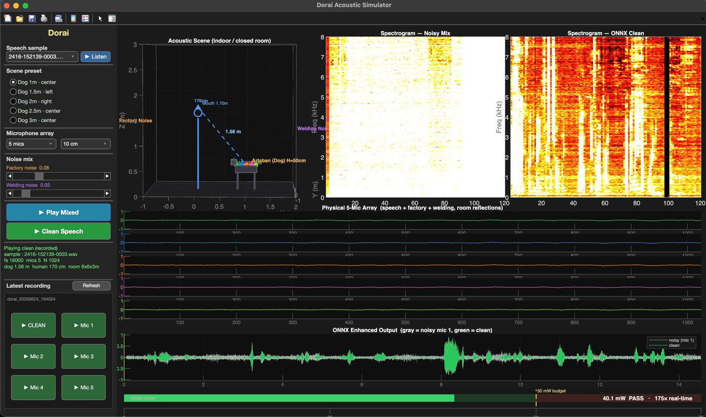

# dorai — ROS 2 Mic-Array Speech Pipeline

`dorai` is a modular 2-stage ROS 2 audio processing pipeline that captures audio from an array of microphones, enhances the multi-channel signals in real time (beamforming), and transcribes the cleaned speech to text.

`voice_mod` runs the full capture-to-enhancement path in a single node: it auto-detects the microphone array, async-resamples every mic to a common 16 kHz timeline with per-mic clock-drift correction, and runs the `dorai_beamformer.ort` beamformer continuously. Enhancement runs on a real-time sliding window with no added algorithmic delay; only the publish of the clean stream is batched into configurable N-second frames (default 10 s). `stt_mod` then transcribes that clean stream with NVIDIA Nemotron streaming ASR (NeMo, via `sherpa-onnx`) plus the dorai fine-tuned workshop adapter, publishing streaming partials and punctuated finals.

`doa_mod` runs alongside them and answers a different question — *where* the
talker is, rather than what they said. It takes the raw array channels, gates
them on voice activity, and publishes the bearing in degrees.

```
                     [ microphone array ]
                        |            |
        +---------------+            +---------------+
        v                                            v
  +-----------+                                +---------+
  | voice_mod |  Mic-array capture +           | doa_mod |  VAD gate + pooled
  |           |  drift-corrected 16 kHz        |         |  SRP-PHAT; publishes
  +-----------+  resample + beamformer         +---------+  a bearing ~5 Hz
        |                                            |
 [/dorai_clean_audio]                          [/dorai_doa]  (degrees, 0-360)
        v
   +---------+
   | stt_mod |  Speech-to-Text (NVIDIA Nemotron + dorai adapter)
   +---------+
        |
 [/dorai_transcript]
```

`voice_mod` and `doa_mod` both want the microphone, and two processes cannot
open one ALSA capture device — run one or the other, or have `voice_mod`
publish its raw tap (`-p publish_raw:=true`) and run `doa_mod -p source:=topic`.
See `doa_mod/README.md`.

---

## Prerequisites

* **Operating System**: Ubuntu 24.04 LTS (Noble) / Ubuntu Server 24.04
* **ROS 2 Distribution**: Jazzy Jalisco (`ros-jazzy-ros-base` or `ros-jazzy-desktop`)
* **System Libraries**:
  ```bash
  sudo apt update
  sudo apt install python3-colcon-common-extensions libportaudio2 libsamplerate0-dev -y
  ```

---

## Installation & Setup

1. **Create a ROS 2 Workspace**:
   Create a workspace directory structure:
   ```bash
   mkdir -p ~/ros2_ws
   ```

2. **Clone/Copy Modules**:
   Place the pipeline package directories (`voice_mod`, `stt_mod`, `doa_mod`) directly inside your workspace. The `doa/` directory is the DoA research tree, not a ROS package — leave it out of the workspace.

3. **Install Python Package Dependencies**:
   Install the required Python packages directly to your user-site location (so they are accessible by the system Python interpreter used by ROS 2):
   ```bash
   pip3 install --user --break-system-packages onnxruntime numpy scipy sounddevice samplerate sherpa-onnx
   ```

   **Nemotron STT model**: the default (1120 ms + dorai `mc-ref` adapter) is bundled in `stt_mod/models/`.
   Other latency profiles/adapters: see [`stt_mod/README.md`](stt_mod/README.md#models). Check that it loads and measure the RTF (no ROS needed):
   ```bash
   python3 -m stt_mod.transcribe stt_mod/models/*/test_wavs/*.wav
   ```

4. **Build the Workspace**:
   Compile the packages using `colcon`:
   ```bash
   colcon build --symlink-install
   ```

5. **Source the Workspace overlay**:
   Source your workspace setup file in each terminal session:
   ```bash
   source ~/ros2_ws/install/setup.bash
   ```

---

## Running the Pipeline

To run the pipeline, start each node in a separate terminal window. Make sure to source the workspace setup script in every terminal.

### 1. Stage 1: Capture + Beamforming (`voice_mod`)

Auto-detects the USB microphone array, async-resamples every mic to a common 16 kHz timeline with per-mic clock-drift correction, runs the `dorai_beamformer.ort` beamformer continuously, and publishes the enhanced single-channel speech in N-second frames:
```bash
ros2 run voice_mod voice
```

#### voice_mod Parameters
* `--ros-args -p publish_interval:=10.0` (Frame length in seconds for the output clean speech; default `10.0` s)
* `--ros-args -p max_mics:=3` (Caps the number of captured channels; default `3`)
* `--ros-args -p requested_rate:=48000` (Preferred capture rate per mic; default `48000` Hz)
* `--ros-args -p include_internal:=false` (Allow built-in/internal microphones; default `false`)
* `--ros-args -p prefer_usb:=true` (Order USB/external mics first; default `true`)
* `--ros-args -p mic_name_filter:=""` (Case-insensitive device-name substring; when set, only inputs whose name contains it are used as array mics. Pins the real array and excludes stray inputs — e.g. an empty dock jack — that would otherwise be auto-selected as a dead channel and collapse the beamformer. Empty = plain auto-detection; default `""`)
* `--ros-args -p capture_channels:=0` (Per-mic capture channel count: `0` = auto (open each device at its native count, capped at 2, then downmix to mono), `1` = force legacy mono open, `2` = force stereo. Some stereo-native USB mics deliver a much weaker signal when opened mono, so auto restores full level while staying single-channel-per-mic downstream; default `0`)
* `--ros-args -p output_topic:=/dorai_clean_audio` (Topic name for enhanced speech; default `/dorai_clean_audio`)
* `--ros-args -p num_threads:=2` (ONNX Runtime intra-op threads; 0 = ORT default, default `2`)
* `--ros-args -p input_latency:=0.0` (PortAudio input latency in seconds, <= 0.0 uses 'high'; default `0.0`)
* `--ros-args -p publish_raw:=false` (Also publish raw, resampled & filtered multi-channel audio; default `false`)
* `--ros-args -p raw_topic:=/dorai_raw_audio` (Topic name for raw multi-channel audio; default `/dorai_raw_audio`)
* `--ros-args -p hpf_hz:=150.0` (Per-mic high-pass filter cutoff frequency in Hz to strip low-frequency rumble, 0.0 disables; default `150.0`)
* `--ros-args -p output_peak:=0.9` (Loudness normalization target peak, 0.0 disables; default `0.9`)
* `--ros-args -p output_max_gain:=12.0` (Maximum gain limit in dB for loudness normalization; default `12.0`)
* `--ros-args -p model_path:=/path/to/dorai_beamformer.ort` (Custom path to the `dorai_beamformer.ort` beamformer model)

*Example — publish clean speech every 5 seconds using up to 4 mics:*
```bash
ros2 run voice_mod voice --ros-args -p publish_interval:=5.0 -p max_mics:=4
```
*Example — publish both raw and clean audio, with custom PortAudio input latency:*
```bash
ros2 run voice_mod voice --ros-args -p publish_raw:=true -p input_latency:=0.05
```

### 2. Stage 2: Speech-To-Text (`stt_mod`)

Streaming NVIDIA `nemotron-speech-streaming-en-0.6b` (NeMo FastConformer + RNN-T, int8 ONNX via sherpa-onnx), with
the dorai fine-tuned workshop adapter `mc-ref` baked in; that default model ships inside the package
(`stt_mod/models/`). It publishes partials and finals:
```bash
ros2 launch stt_mod stt.launch.py                          # 1120 ms profile, mc-ref, 2 threads
ros2 run stt_mod stt --ros-args -p latency_ms:=560 -p num_threads:=4
```
Key parameters: `latency_ms` (80 | 160 | 560 | 1120), `adapter` (mc-ref | mc-das | none), `num_threads`,
`ep_rule2_sil` (0 = auto per profile). The full table, the measured
latency/accuracy behind each default, and the adapter bake tool are in [`stt_mod/README.md`](stt_mod/README.md).

* On a Pi 4, no profile decodes in real time (1120 ms reaches RTF ≈ 1.7). The node queues audio rather than
  dropping it and reports `backlog_s` on `/dorai_stt/status`. When it runs on the same Pi as `voice_mod`,
  start voice_mod with `-p input_latency:=0.25`; at 0.0 the STT load caused capture overflows (see `test/sim_pipeline.sh`).

---

### 3. Direction of Arrival (`doa_mod`)

Publishes the talker bearing. Needs the **raw** array channels on one clock, so
it either owns the device or reads `voice_mod`'s raw tap.

```bash
ros2 run doa_mod doa
```

#### doa_mod Parameters

| Parameter | Default | Description |
| :--- | :--- | :--- |
| `source` | `mic` | `mic` opens the device directly; `topic` reads `/dorai_raw_audio`. |
| `device_channels` | `6` | Channels to open (the ReSpeaker 4-Mic exposes 6). |
| `channels` | `[1,2,3,4]` | Which of those are the raw capsules. |
| `radius_mm` | `32.0` | Built-in ReSpeaker geometry. |
| `positions_mm` | `""` | Explicit `"x,y x,y ..."` per mic in channel order; overrides `radius_mm`. |
| `vad_mode` | `neural` | `neural` (vad.onnx), `energy` (RMS, no model), or `off` (no gating). |
| `vad_hangover_ms` | `800` | How long publishing outlives the last speech frame. |
| `avg_tc` | `0.5` | Pooling time constant (s). Longer = steadier; shorter tracks movement sooner. |
| `publish_period` | `0.2` | Seconds between bearings. |

Run without the neural VAD (drops the `onnxruntime` dependency):

```bash
ros2 run doa_mod doa --ros-args -p vad_mode:=energy
```

Alongside a running `voice_mod`:

```bash
ros2 run voice_mod voice --ros-args -p publish_raw:=true
ros2 run doa_mod  doa   --ros-args -p source:=topic
```

> **Before trusting the output**, verify the geometry is not mirrored: put a
> talker at 90°, then at 0°. If 90° reads correctly and 0° does not, the
> channel order is mirrored — that is not an offset and cannot be calibrated
> away. See `doa_mod/README.md`.

---

## Pipeline Topics

The audio data published on `/dorai_clean_audio` and `/dorai_raw_audio` includes a 4-float header at the start of the data array:
1. `capture_s`: True PortAudio ADC capture time (seconds since node startup).
2. `sample_rate`: Master timeline rate (always `16000.0` Hz).
3. `num_channels`: Number of channels (`1.0` for clean, or active mics count `M` for raw).
4. `sequence_number`: Running frame counter.

The audio samples follow the header in interleaved format: `[ch1_s1, ch2_s1, ..., chM_s1, ch1_s2, ...]`.

| Topic | Data Type | Description |
| :--- | :--- | :--- |
| `/dorai_clean_audio` | `std_msgs/Float32MultiArray` | Enhanced single-channel 16 kHz speech, published in N-second frames. |
| `/dorai_raw_audio` | `std_msgs/Float32MultiArray` | Raw multi-channel 16 kHz speech (resampled & filtered), published only if `publish_raw:=true`. |
| `/dorai_transcript` | `std_msgs/String` | Final transcribed text results. |
| `/dorai_partial_transcript` | `std_msgs/String` | Running hypothesis, updated every encoder chunk. |
| `/dorai_stt/status` | `std_msgs/String` | JSON: `rtf`, `backlog_s`, `finals`, `lag_median_s`, `model`. |
| `/voice_mod/diagnostics` | `std_msgs/String` | Per-mic rate, FIFO/backlog, underruns, xruns, and drift ratio. |
| `/dorai_doa` | `std_msgs/Float32` | Talker bearing in degrees, 0–360, CCW from the array's +x axis. Published only while speech is present. |
| `/dorai_doa/state` | `std_msgs/Float32MultiArray` | `[elapsed_s, azimuth_deg, sharpness, consistent_frac, speech_flag, seq]`. |
| `/dorai_doa/human` | `std_msgs/String` | The same state in plain words, for `ros2 topic echo` (`-p publish_human:=false` to disable). Format is for eyes, not a contract. |
| `/doa_mod/diagnostics` | `std_msgs/String` | Frames seen, speech fraction, gate pass rate, worker duty cycle. |

`/dorai_doa` does **not** use the 4-float header convention — it carries a
single number. It falls silent when nobody is talking, so consumers should
treat "no message" as "no talker" rather than holding the last value
indefinitely.

---

## Acoustic Simulator (Lab)

The workspace includes an offline, MATLAB-based physical acoustic simulator inside the [lab/](lab) directory. 



* **Overview**: It simulates a closed room (acoustic space) containing a human speaker standing near an **Artaban robotic dog** equipped with a microphone array on its back.
* **Propagation Physics**: Models 3D sound waves reflecting off room boundaries (floor, ceiling, walls) using the **Image Source Method (ISM)**, mixing human speech with industrial factory and welding noise.
* **Dry Runs**: Feeds the simulated noisy channels directly into `dorai_beamformer.ort` for DSP benchmarking and visualizes speech cleanup.
* **Documentation**: See [lab/README.md](lab/README.md) for detailed abstraction, room dimensions, placement coordinates, diagrams, and execution instructions.
