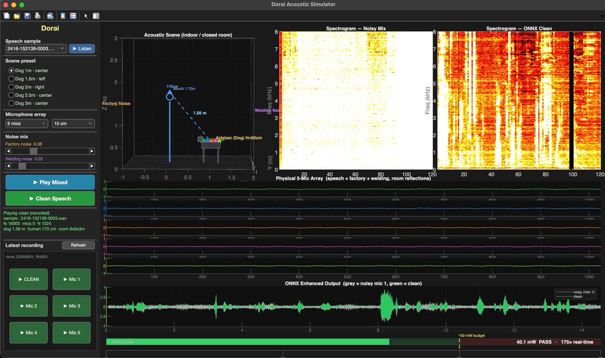

# dorai — ROS 2 Mic-Array Speech Pipeline

`dorai` is a modular 3-stage ROS 2 speech pipeline. It captures audio from an array of microphones, enhances the multi-channel signals in real time (beamforming), transcribes the cleaned speech to text, and turns each spoken command for the **Artaban** robot into a validated JSON plan.

`voice_mod` runs the full capture-to-enhancement path in a single node: it auto-detects the microphone array, async-resamples every mic to a common 16 kHz timeline with per-mic clock-drift correction, and runs the `dorai_beamformer.ort` beamformer continuously. Enhancement runs on a real-time sliding window with no added algorithmic delay; only the publish of the clean stream is batched into configurable N-second frames (default 10 s). `stt_mod` then transcribes that clean stream with NVIDIA Nemotron streaming ASR (NeMo, via `sherpa-onnx`) plus the dorai fine-tuned workshop adapter, publishing streaming partials and punctuated finals. `intent_mod` reads those finals and does three things:
- It sends stop commands straight to `/dorai_stop`, without waiting for the model.
- It drops speech that isn't addressed to "Artaban".
- It turns each command into a small JSON plan with **Qwen3.5-4B fine-tuned (LoRA) on Artaban commands**, run as a GGUF through llama.cpp. The model is downloaded from Hugging Face on first start.

`doa_mod` runs alongside them and answers a different question — *where* the
talker is, rather than what they said. It takes the raw array channels, gates
them on voice activity, and publishes the bearing in degrees.

```
                     [ microphone array ]
                        |            |
        +---------------+            +---------------+
        v                                            v
  +-----------+                                +---------+
  | voice_mod |  Mic-array capture +           | doa_mod |  VAD gate + pooled
  |           |  drift-corrected 16 kHz        |         |  SRP-PHAT; publishes
  +-----------+  resample + beamformer         +---------+  a bearing ~5 Hz
        |                                            |
 [/dorai_clean_audio]                          [/dorai_doa]  (degrees, 0-360)
        v
   +---------+
   | stt_mod |  Speech-to-Text (fine-tuned Whisper behind a VAD gate; or Nemotron)
   +---------+
        |
 [/dorai_transcript]
        v
  +------------+
  | intent_mod |  stop gate + wake word + Qwen3.5-4B LoRA (GGUF)
  +------------+  -> validated JSON plan
        |
 [/dorai_plan]  [/dorai_say]  [/dorai_stop]
```

`voice_mod` and `doa_mod` both want the microphone, and two processes cannot
open one ALSA capture device — run one or the other, or have `voice_mod`
publish its raw tap (`-p publish_raw:=true`) and run `doa_mod -p source:=topic`.
See `doa_mod/README.md`.

---

## Prerequisites

* **Operating System**: Ubuntu 24.04 LTS (Noble) / Ubuntu Server 24.04
* **ROS 2 Distribution**: Jazzy Jalisco (`ros-jazzy-ros-base` or `ros-jazzy-desktop`)
* **System Libraries**:
  ```bash
  sudo apt update
  sudo apt install python3-colcon-common-extensions libportaudio2 libsamplerate0-dev -y
  ```

---

## Installation & Setup

1. **Create a ROS 2 Workspace**:
   Create a workspace directory structure:
   ```bash
   mkdir -p ~/ros2_ws
   ```

2. **Clone/Copy Modules**:
   Place the pipeline package directories (`voice_mod`, `stt_mod`, `intent_mod`, `doa_mod`) directly inside your workspace. The `doa/` directory is the DoA research tree, not a ROS package — leave it out of the workspace.

3. **Install Python Package Dependencies**:
   Install the required Python packages directly to your user-site location (so they are accessible by the system Python interpreter used by ROS 2):
   ```bash
   pip3 install --user --break-system-packages onnxruntime numpy scipy sounddevice samplerate sherpa-onnx
   ```

   **Models**: every dorai model is in one Hugging Face repo, [huggingface.co/sensifai/dorai](https://huggingface.co/sensifai/dorai/tree/main):

   | Path in the repo | Size | Used by |
   | :--- | ---: | :--- |
   | `stt-model/whisper-finetuned/sherpa-onnx-whisper-large-v3-turbo-dorai-artaban/` | 1.0 GB | `stt_mod`, default engine (fine-tuned Whisper) |
   | `stt-model/nemo-finetuned/` | 0.67 GB | `stt_mod`, `engine:=nemotron` (1120 ms + dorai `mc-ref` adapter) and the fallback when Whisper is missing |
   | `intent-model/intent-qwen35-4b-Q4_0.gguf` | 2.6 GB | `intent_mod` |

   **STT models**: nothing is bundled in the package; download them once into `~/dorai/models/` (the nodes look there on their own):
   ```bash
   bash stt_mod/scripts/download_models.sh                     # Whisper + Nemotron, 1.7 GB
   MODELS="whisper nemotron intent" bash stt_mod/scripts/download_models.sh   # + the intent model, for an offline robot
   ```
   Details and other ways: [`stt_mod/README.md`](stt_mod/README.md#models). Check that a model loads and measure the RTF (no ROS needed):
   ```bash
   python3 -m stt_mod.transcribe --list                                              # what is installed
   python3 -m stt_mod.transcribe --engine nemotron ~/dorai/models/stt-model/nemo-finetuned/test_wavs/*.wav
   ```

   **Intent LLM runtime** (intent_mod). Use 0.3.36 or newer, the first release with Qwen3.5 support. It builds from source on ARM, which takes several minutes on a Pi. Without it, intent_mod falls back to its rule parser:
   ```bash
   CMAKE_BUILD_PARALLEL_LEVEL=4 pip3 install --user --break-system-packages "llama-cpp-python>=0.3.36" jinja2
   ```

   **Intent model**: `intent-qwen35-4b-Q4_0.gguf` (2.6 GB) lives in the same repo, at
   [`intent-model/`](https://huggingface.co/sensifai/dorai/tree/main/intent-model).
   You don't need to fetch it by hand: the first `intent_mod` start downloads it into `~/dorai/models/`. The download resumes after an interruption and is checked against its sha256. For an offline robot, copy the file there beforehand:
   ```bash
   mkdir -p ~/dorai/models && hf download sensifai/dorai intent-model/intent-qwen35-4b-Q4_0.gguf --local-dir ~/dorai/models
   ```

4. **Build the Workspace**:
   Compile the packages using `colcon`:
   ```bash
   colcon build --symlink-install
   ```

5. **Source the Workspace overlay**:
   Source your workspace setup file in each terminal session:
   ```bash
   source ~/ros2_ws/install/setup.bash
   ```

---

## Running the Pipeline

To run the pipeline, start each node in a separate terminal window. Make sure to source the workspace setup script in every terminal.

### 1. Stage 1: Capture + Beamforming (`voice_mod`)

Auto-detects the USB microphone array, async-resamples every mic to a common 16 kHz timeline with per-mic clock-drift correction, runs the `dorai_beamformer.ort` beamformer continuously, and publishes the enhanced single-channel speech in N-second frames:
```bash
ros2 run voice_mod voice
```

#### voice_mod Parameters
* `--ros-args -p publish_interval:=10.0` (Frame length in seconds for the output clean speech; default `10.0` s)
* `--ros-args -p max_mics:=3` (Caps the number of captured channels; default `3`)
* `--ros-args -p requested_rate:=48000` (Preferred capture rate per mic; default `48000` Hz)
* `--ros-args -p include_internal:=false` (Allow built-in/internal microphones; default `false`)
* `--ros-args -p prefer_usb:=true` (Order USB/external mics first; default `true`)
* `--ros-args -p mic_name_filter:=""` (Case-insensitive device-name substring; when set, only inputs whose name contains it are used as array mics. Pins the real array and excludes stray inputs — e.g. an empty dock jack — that would otherwise be auto-selected as a dead channel and collapse the beamformer. Empty = plain auto-detection; default `""`)
* `--ros-args -p capture_channels:=0` (Per-mic capture channel count: `0` = auto (open each device at its native count, capped at 2, then downmix to mono), `1` = force legacy mono open, `2` = force stereo. Some stereo-native USB mics deliver a much weaker signal when opened mono, so auto restores full level while staying single-channel-per-mic downstream; default `0`)
* `--ros-args -p output_topic:=/dorai_clean_audio` (Topic name for enhanced speech; default `/dorai_clean_audio`)
* `--ros-args -p num_threads:=2` (ONNX Runtime intra-op threads; 0 = ORT default, default `2`)
* `--ros-args -p input_latency:=0.0` (PortAudio input latency in seconds, <= 0.0 uses 'high'; default `0.0`)
* `--ros-args -p publish_raw:=false` (Also publish raw, resampled & filtered multi-channel audio; default `false`)
* `--ros-args -p raw_topic:=/dorai_raw_audio` (Topic name for raw multi-channel audio; default `/dorai_raw_audio`)
* `--ros-args -p hpf_hz:=150.0` (Per-mic high-pass filter cutoff frequency in Hz to strip low-frequency rumble, 0.0 disables; default `150.0`)
* `--ros-args -p output_peak:=0.9` (Loudness normalization target peak, 0.0 disables; default `0.9`)
* `--ros-args -p output_max_gain:=12.0` (Maximum gain limit in dB for loudness normalization; default `12.0`)
* `--ros-args -p model_path:=/path/to/dorai_beamformer.ort` (Custom path to the `dorai_beamformer.ort` beamformer model)

*Example — publish clean speech every 5 seconds using up to 4 mics:*
```bash
ros2 run voice_mod voice --ros-args -p publish_interval:=5.0 -p max_mics:=4
```
*Example — publish both raw and clean audio, with custom PortAudio input latency:*
```bash
ros2 run voice_mod voice --ros-args -p publish_raw:=true -p input_latency:=0.05
```

### 2. Stage 2: Speech-To-Text (`stt_mod`)

Two engines, both int8 ONNX through sherpa-onnx, chosen with `engine`:

* `whisper` (default): Whisper large-v3-turbo with the dorai command fine-tune. The clean stream is cut into
  utterances by a neural VAD gate (`vad_gated.onnx`, shipped in the package) and each utterance is decoded once,
  when the talker stops; audio the gate does not pass is never decoded, so noise gives no text. Finals only.
* `nemotron`: streaming NVIDIA `nemotron-speech-streaming-en-0.6b` (NeMo FastConformer + RNN-T) with the dorai
  fine-tuned workshop adapter `mc-ref` baked in. Partials and finals. Also what the node runs, with an error in
  the log, when the Whisper model is not installed (`engine_fallback`).

The models come from [huggingface.co/sensifai/dorai](https://huggingface.co/sensifai/dorai/tree/main)
(`bash stt_mod/scripts/download_models.sh`).
```bash
ros2 launch stt_mod stt.launch.py                          # Whisper behind the VAD gate, 2 threads
ros2 run stt_mod stt --ros-args -p engine:=nemotron        # streaming engine, 1120 ms profile, mc-ref
```
Key parameters: `engine` (whisper | nemotron), `vad` (neural | energy | none), `vad_min_silence_s`, `num_threads`;
for Nemotron `latency_ms` and `adapter` (mc-ref | mc-das | none). The full table, the measured
latency/accuracy behind the defaults, and the adapter bake tool are in [`stt_mod/README.md`](stt_mod/README.md).

* On a Pi 4, no Nemotron profile decodes in real time (1120 ms reaches RTF ≈ 1.7), and Whisper has not been timed there. The node queues audio rather than
  dropping it and reports `backlog_s` on `/dorai_stt/status`. When it runs on the same Pi as `voice_mod`,
  start voice_mod with `-p input_latency:=0.25`; at 0.0 the STT load caused capture overflows (see `test/sim_pipeline.sh`).

### 3. Stage 3: Intent (`intent_mod`)

Turns each final transcript into an Artaban plan:
```
"Artaban, go to welding station two and check the meter"
  -> /dorai_plan {"steps":[{"task":"inspect_meter","target":"welder_2"}]}
```
```bash
ros2 launch intent_mod intent.launch.py                       # wake word required, model auto-downloaded on first start
ros2 launch intent_mod intent.launch.py require_wake:=false   # every transcript is a command
ros2 topic pub --once /dorai_transcript std_msgs/String "{data: 'Artaban look at the welding torch'}"
ros2 topic echo /dorai_plan
```

**How a transcript is handled:**
1. **Stop gate.** "Artaban stop", "halt" and "e-stop" go to `/dorai_stop` immediately, even while the model is busy. A stop never goes through the LLM.
2. **Wake word.** With `require_wake:=true` (default), speech not addressed to "Artaban" is ignored. The matcher tolerates STT misspellings such as "Arteban".
3. **Model.** The LLM writes a JSON plan using only the tasks, places and objects in `config/locations.yaml`. New places need no retraining.
4. **Checks.** `schema.validate()` checks every task, argument, enum value, place and object. The grounding guard asks "did you mean X?" when the plan names a place nobody said.
5. **Output.** Unclear or unknown requests become a spoken question on `/dorai_say`, not a guessed action.

**Tasks:**
- **Movement:** goto, come_here, follow_me, turn, move, go_back, wait, posture (sit / stand / lie down), dock, set_speed
- **Inspection:** inspect_meter, inspect_visual, read_meter, inspection start/stop, look_at
- **Tools:** weld, gripper, arm, pick, bring, hold, lights
- **Dialogue:** report, cancel, confirm, clarify, none

#### intent_mod Parameters

| Parameter | Default | Description |
| :--- | :--- | :--- |
| `engine` | `auto` | `auto` (LLM if the model loads, else rules), `llm` (fail if missing), `rules`. |
| `model` | `intent-qwen35-4b-Q4_0.gguf` | File name (searched in the model roots), absolute path, or huggingface.co file URL. |
| `models_dir` | `""` | Extra model root searched first; downloads go here (`""` = `~/dorai/models`). |
| `hf_repo` | `sensifai/dorai` | Where a missing model is downloaded from. A private repo needs `$HF_TOKEN`. |
| `hf_subdir` | `intent-model` | Folder of that repo the model file is in. |
| `auto_download` | `true` | `false` never touches the network; a missing model then falls back to rules. |
| `require_wake` | `true` | Only act on speech addressed to `wake_word` (`artaban`). Stop always works. |
| `num_threads` | `2` | llama.cpp threads. |
| `use_grammar` | `false` | JSON-grammar-constrained decoding: slower, and same accuracy with this model. |
| `grounding_guard` | `true` | Ask "did you mean X?" instead of acting on an unsaid place. |
| `locations_file` | `""` | The site's places and objects (default: package `config/locations.yaml`). |

*Example — pin a local file and stay offline:*
```bash
ros2 launch intent_mod intent.launch.py model:=/data/models/intent-qwen35-4b-Q4_0.gguf auto_download:=false
```

**Accuracy.** These are exact-plan matches on test sets the model never saw in training:

| Engine | Dev | Test | Paraphrase |
| :--- | ---: | ---: | ---: |
| Qwen3.5-4B LoRA (this model) | 98.0 % | 98.3 % | 92.6 % |
| Rule fallback | 69 % | 51 % | 46 % |

**Live test.** voice_mod → stt_mod → intent_mod in a simulated welding shop: 10/10 commands right on exact text, and 85 % right on clean speech. In welding noise the losses come from STT. Intent latency was about 0.5 s on an M4-class VM; Pi 4 latency is not measured yet.

Rebuilding the model and the full details are in [`intent_mod/README.md`](intent_mod/README.md).

---

### 4. Direction of Arrival (`doa_mod`)

Publishes the talker bearing. Needs the **raw** array channels on one clock, so
it either owns the device or reads `voice_mod`'s raw tap.

```bash
ros2 run doa_mod doa
```

#### doa_mod Parameters

| Parameter | Default | Description |
| :--- | :--- | :--- |
| `source` | `mic` | `mic` opens the device directly; `topic` reads `/dorai_raw_audio`. |
| `device_channels` | `6` | Channels to open (the ReSpeaker 4-Mic exposes 6). |
| `channels` | `[1,2,3,4]` | Which of those are the raw capsules. |
| `radius_mm` | `32.0` | Built-in ReSpeaker geometry. |
| `positions_mm` | `""` | Explicit `"x,y x,y ..."` per mic in channel order; overrides `radius_mm`. |
| `vad_mode` | `neural` | `neural` (vad.onnx), `energy` (RMS, no model), or `off` (no gating). |
| `vad_hangover_ms` | `800` | How long publishing outlives the last speech frame. |
| `avg_tc` | `0.5` | Pooling time constant (s). Longer = steadier; shorter tracks movement sooner. |
| `publish_period` | `0.2` | Seconds between bearings. |

Run without the neural VAD (drops the `onnxruntime` dependency):

```bash
ros2 run doa_mod doa --ros-args -p vad_mode:=energy
```

Alongside a running `voice_mod`:

```bash
ros2 run voice_mod voice --ros-args -p publish_raw:=true
ros2 run doa_mod  doa   --ros-args -p source:=topic
```

> **Before trusting the output**, verify the geometry is not mirrored: put a
> talker at 90°, then at 0°. If 90° reads correctly and 0° does not, the
> channel order is mirrored — that is not an offset and cannot be calibrated
> away. See `doa_mod/README.md`.

---

## Pipeline Topics

The audio data published on `/dorai_clean_audio` and `/dorai_raw_audio` includes a 4-float header at the start of the data array:
1. `capture_s`: True PortAudio ADC capture time (seconds since node startup).
2. `sample_rate`: Master timeline rate (always `16000.0` Hz).
3. `num_channels`: Number of channels (`1.0` for clean, or active mics count `M` for raw).
4. `sequence_number`: Running frame counter.

The audio samples follow the header in interleaved format: `[ch1_s1, ch2_s1, ..., chM_s1, ch1_s2, ...]`.

| Topic | Data Type | Description |
| :--- | :--- | :--- |
| `/dorai_clean_audio` | `std_msgs/Float32MultiArray` | Enhanced single-channel 16 kHz speech, published in N-second frames. |
| `/dorai_raw_audio` | `std_msgs/Float32MultiArray` | Raw multi-channel 16 kHz speech (resampled & filtered), published only if `publish_raw:=true`. |
| `/dorai_transcript` | `std_msgs/String` | Final transcribed text results. |
| `/dorai_partial_transcript` | `std_msgs/String` | Running hypothesis, updated every encoder chunk. |
| `/dorai_stt/status` | `std_msgs/String` | JSON: `rtf`, `backlog_s`, `finals`, `lag_median_s`, `model`. |
| `/dorai_plan` | `std_msgs/String` | JSON `{"text", "plan": {"steps": [...]}, "bearing_deg", "engine", "latency_s", "stamp"}`; validated, actionable plans only. |
| `/dorai_say` | `std_msgs/String` | Question or refusal to speak (unclear command, unknown place, "did you mean X?"). |
| `/dorai_stop` | `std_msgs/String` | `stop` or `estop`, published immediately on a stop command. |
| `/dorai_intent/status` | `std_msgs/String` | JSON: engine, model, plan/clarify/stop counts, mean latency, queue depth. |
| `/voice_mod/diagnostics` | `std_msgs/String` | Per-mic rate, FIFO/backlog, underruns, xruns, and drift ratio. |
| `/dorai_doa` | `std_msgs/Float32` | Talker bearing in degrees, 0–360, CCW from the array's +x axis. Published only while speech is present. |
| `/dorai_doa/state` | `std_msgs/Float32MultiArray` | `[elapsed_s, azimuth_deg, sharpness, consistent_frac, speech_flag, seq]`. |
| `/dorai_doa/human` | `std_msgs/String` | The same state in plain words, for `ros2 topic echo` (`-p publish_human:=false` to disable). Format is for eyes, not a contract. |
| `/doa_mod/diagnostics` | `std_msgs/String` | Frames seen, speech fraction, gate pass rate, worker duty cycle. |

`/dorai_doa` does **not** use the 4-float header convention — it carries a
single number. It falls silent when nobody is talking, so consumers should
treat "no message" as "no talker" rather than holding the last value
indefinitely.

---

## Acoustic Simulator (Lab)

The workspace includes an offline, MATLAB-based physical acoustic simulator inside the [lab/](lab) directory. 



* **Overview**: It simulates a closed room (acoustic space) containing a human speaker standing near an **Artaban robotic dog** equipped with a microphone array on its back.
* **Propagation Physics**: Models 3D sound waves reflecting off room boundaries (floor, ceiling, walls) using the **Image Source Method (ISM)**, mixing human speech with industrial factory and welding noise.
* **Dry Runs**: Feeds the simulated noisy channels directly into `dorai_beamformer.ort` for DSP benchmarking and visualizes speech cleanup.
* **Documentation**: See [lab/README.md](lab/README.md) for detailed abstraction, room dimensions, placement coordinates, diagrams, and execution instructions.
